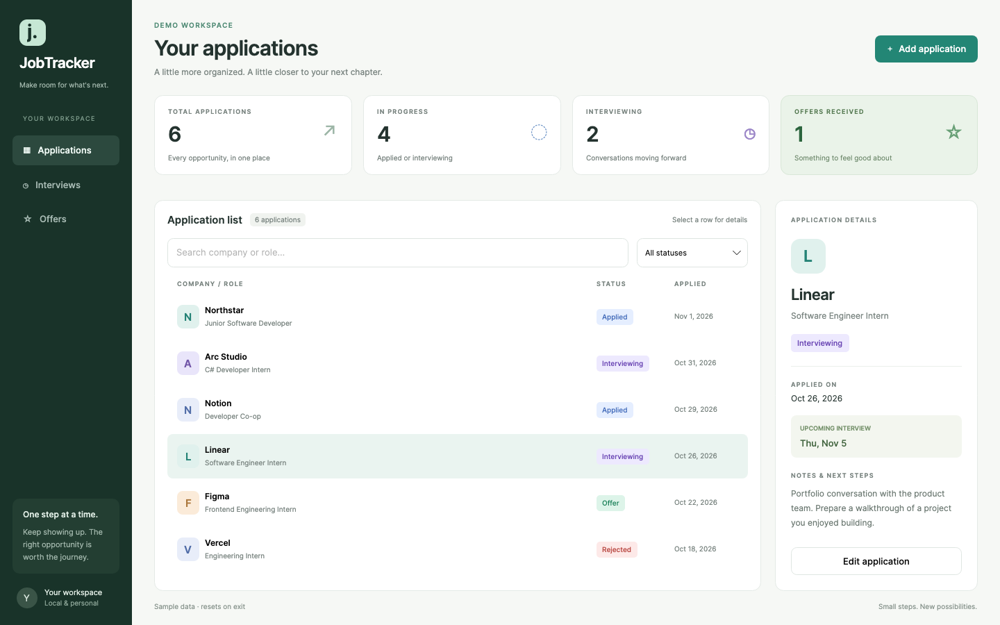

# JobTracker

**A calmer place for your next chapter.** A C# / .NET desktop app built with Avalonia, XAML, and MVVM. Track your job applications, interviews, offers, and next steps in a clean, personal workspace on macOS, Windows, or Linux.



## What's inside

- A clean application list with company initials and color-coded status badges.
- Summary cards for total applications, active applications, interviews, and offers.
- Instant company/role search and a status filter that work together.
- An adjacent details panel with full names, interview dates, and notes.
- Simple add/edit forms with calendar pickers and helpful validation.
- Upcoming interviews sorted by date, and a separate offers view.
- Unsaved-change protection, keyboard shortcuts, and visible save feedback.
- Local JSON storage, safe file replacement, and compatibility with the original console app's data.
- An isolated demo mode so you can explore without touching your real applications.

The screenshot uses fictional demo records; your workspace starts empty. This is an independent personal project, not affiliated with the companies mentioned in its demo.

## Run on your Mac

1. Install the **[.NET 10 SDK](https://dotnet.microsoft.com/en-us/download/dotnet/10.0)**. For Apple Silicon (M1/M2/M3/M4 and later), choose Arm64; for an Intel Mac, choose x64.
2. Download/extract this repository, or clone it. Open the `JobApplicationTracker` folder in VS Code with Microsoft's **C# Dev Kit** extension.
3. In **Terminal → New Terminal**, run:

```bash
dotnet run --project src/JobTracker
```

A desktop window opens. You only need the terminal to launch from source; all tracking happens in the graphical interface. The first run downloads Avalonia's packages from NuGet and needs internet access. Later use of the app is local and does not require a network connection.

To open a temporary workspace filled with sample applications:

```bash
dotnet run --project src/JobTracker -- --demo
```

## Run on Windows

Install the .NET 10 SDK, open the extracted project folder in Terminal, and use the same `dotnet run --project src/JobTracker` command. Or open `JobApplicationTracker.sln` in a .NET 10-compatible Visual Studio installation, set **JobTracker** as the startup project, and run it. VS Code with C# Dev Kit also works.

On Linux, use the same command with the .NET 10 SDK and Avalonia's [Linux desktop prerequisites](https://docs.avaloniaui.net/docs/get-started/install-avalonia).

## A quick walkthrough

1. Click **Add application**. Enter a company, job title, and application date. Add a status, optional interview date, and notes.
2. Click **Add application** in the form. The record appears in your list and is saved immediately.
3. Select any application to read its details. Click **Edit application** to change any field, then **Save changes**.
4. Search company names or roles, or choose a status in the dropdown.
5. Click **Interviews** for active applications with an interview today or later. Click **Offers** to focus on offers.

The applied date defaults to today. Choose dates with the calendar icon; **Clear** removes an optional interview date. An interview cannot be earlier than the application date. Status is set manually. Editing a record returns you to all applications so the updated record stays visible even when its status changed.

Canceling a changed form asks whether to discard changes. Closing the window while editing also opens this prompt; discard the form, then close the window again if you want to exit.

### Keyboard shortcuts

| Action | macOS | Windows / Linux |
|---|---|---|
| New application | Cmd+N | Ctrl+N |
| Search | Cmd+F | Ctrl+F |
| Save open form | Cmd+S | Ctrl+S |
| Cancel open form | Esc | Esc |

Tab moves between controls. The modal form keeps the underlying workspace disabled while editing. Company and role are required. Full company names and roles remain available in the details panel when a list row truncates them.

## Build an app you can open directly

### macOS

From the project root:

```bash
bash scripts/package-macos.sh osx-arm64
```

Use `osx-x64` for Intel. The script creates `dist/osx-arm64/JobTracker.app` (or `dist/osx-x64/JobTracker.app`). Open it in Finder; you can copy it to Applications. It includes the .NET runtime, so the packaged app does not need a separately installed SDK.

The script uses a local ad-hoc signature. It does **not** provide an Apple Developer ID or notarization. Public distribution to other Macs requires appropriate signing/notarization; building locally from source is the simplest development workflow.

### Windows

```powershell
dotnet publish src/JobTracker -c Release -r win-x64 --self-contained true -o dist/windows
```

Open `dist/windows/JobTracker.exe`. Keep all files in that folder together. Use `win-arm64` for Windows on ARM. Public distribution may require code signing.

## Your data

The app uses the same filename and JSON format as the previous console version. Existing records load automatically on the same machine:

| Platform | Default location |
|---|---|
| Windows | `%LOCALAPPDATA%\JobTracker\applications.json` |
| macOS | `~/Library/Application Support/JobTracker/applications.json` |
| Linux | Your .NET LocalApplicationData directory, typically `~/.local/share/JobTracker/applications.json` |

Hover over the bottom-left saved-locally label to see the actual path. To use another file:

```bash
dotnet run --project src/JobTracker -- --data ./practice-applications.json
```

Data is plain-text JSON, stays on your device, and is not encrypted or synced. Back up the file periodically. Saves first write beside the target and then replace it; a failed save keeps the old in-memory records and the filled-in form. Invalid existing data produces an error and disables editing instead of overwriting the file. Close the app, back up and repair the file, then reopen.

A workspace lock prevents two desktop instances from editing the same file. The `.lock` file can remain on disk after closing; only the open file handle owns the lock. Demo mode uses a separate temporary file and removes it on normal exit. It never seeds or changes your real applications.

## Beginner-friendly architecture

```text
src/
  JobTracker.Core/
    JobApplication.cs          Data record and status enum
    ApplicationTracker.cs      Adding, updating, validation, and searching
    ApplicationStore.cs        JSON loading and safe file replacement
  JobTracker/
    App.axaml                  Shared theme, colors, and control styles
    App.axaml.cs               Startup, workspace path, and instance lock
    Program.cs                 Avalonia entry point
    DemoData.cs                Sample records for the isolated demo
    Views/
      MainWindow.axaml         Layout, templates, and compiled data bindings
      MainWindow.axaml.cs      Window events and keyboard/focus behavior
    ViewModels/
      MainViewModel.cs         Filtering, selection, summary, and commands
      ApplicationEditor.cs     Form state and validation
      ApplicationRow.cs        Display text and status colors
      ObservableObject.cs      Property notifications and commands
tests/JobTracker.Tests/         Core, view-model, and headless UI checks
scripts/package-macos.sh        Self-contained macOS app packaging
```

**MVVM in this app:** the model is your saved application data; the view is the XAML window; view models expose the values and commands the screen needs. Data binding keeps the screen in sync when those values change. The code behind handles keyboard and focus behavior, while business rules and file operations stay out of the view.

Start with `JobApplication.cs`, then `ApplicationTracker.cs`, `ApplicationEditor.cs`, and `MainViewModel.cs`. Read `MainWindow.axaml` last to see how its bindings connect everything.

## Build and test

```bash
dotnet build JobApplicationTracker.sln --configuration Release
dotnet run --project tests/JobTracker.Tests --configuration Release --no-build
```

The test executable prints PASS/FAIL and returns a nonzero code on failure. Run it with `dotnet run`, rather than `dotnet test`. It uses isolated temporary files, never your real application data. It needs no display: Avalonia.Headless loads the actual XAML and exercises form input, commands, and result bindings.

Checks cover persistence, validation, full-field updates, searches and combined filters, interview ordering, counters, cancel/discard behavior, saving under a filter, corrupt files, failed saves, demo isolation, and the actual window's add/save/search flow. GitHub Actions builds and runs checks on Windows, macOS, and Linux.

To regenerate the screenshots from the actual Avalonia controls:

```bash
dotnet run --project tests/JobTracker.Tests -c Release -- --screenshots docs/images
```

## Troubleshooting

- **`dotnet` not found:** install the SDK and reopen VS Code / Terminal.
- **SDK too old:** verify `dotnet --version` starts with `10.` or use a newer SDK supporting .NET 10.
- **Package download fails:** check your connection to NuGet, then run `dotnet restore`.
- **Workspace cannot open:** close other instances and check folder permissions. The app shows the failing path.
- **No upcoming interviews:** ensure the date is today or later and status is Applied or Interviewing.

Built with [.NET](https://dotnet.microsoft.com/) and [Avalonia](https://avaloniaui.net/). This app currently tracks one interview date per application, has no deletion feature, and does not submit applications or connect to job websites.
